  <picture>
    <source media="(prefers-color-scheme: dark)" srcset="./assets/hero-dark.svg" />
    <source media="(prefers-color-scheme: light)" srcset="./assets/hero-light.svg" />
    
  </picture>

  <picture>
    <source media="(prefers-color-scheme: dark)" srcset="https://readme-typing-svg.herokuapp.com/?font=Fira+Code&weight=500&size=19&duration=2600&pause=800&color=7AA2F7&center=true&vCenter=true&width=640&height=36&lines=Full-Stack+Web+%26+Mobile+Developer;TypeScript+%7C+Next.js+%7C+Laravel+%7C+Flutter+%7C+Kotlin;Building+Clean+%26+Practical+Software" />
    <source media="(prefers-color-scheme: light)" srcset="https://readme-typing-svg.herokuapp.com/?font=Fira+Code&weight=500&size=19&duration=2600&pause=800&color=1D4ED8&center=true&vCenter=true&width=640&height=36&lines=Full-Stack+Web+%26+Mobile+Developer;TypeScript+%7C+Next.js+%7C+Laravel+%7C+Flutter+%7C+Kotlin;Building+Clean+%26+Practical+Software" />
    
  </picture>

  
  
  
  

---

## 👨‍💻 About Me

Hi! I'm **Muhammad Irham Bachtiar** (`@starfollowme`), a **Full-Stack Web & Mobile Developer** based in **Bandung, Indonesia** 🇮🇩. I enjoy turning real-world workflows into clean, reliable software across modern web and mobile stacks.

<table>
  <tr>
    <td width="58%" valign="top">
      <h3>🧭 Focus Areas</h3>
      <ul>
        <li><b>Web Applications</b> — Modern UIs &amp; full-stack apps with <code>Next.js</code>, <code>React</code>, <code>TypeScript</code>, and <code>Laravel</code></li>
        <li><b>Mobile Development</b> — Cross-platform &amp; native Android apps with <code>Flutter</code> and <code>Kotlin</code></li>
        <li><b>Academic &amp; Business Systems</b> — Attendance, library, LMS, grading, and marketplace tools</li>
      </ul>
      <h3>⚡ Quick Snapshot</h3>
      <ul>
        <li>📍 <b>Based in:</b> Bandung, Indonesia</li>
        <li>🛠️ <b>Core Stack:</b> TypeScript, Laravel, Flutter, Kotlin</li>
        <li>📦 <b>Public Repos:</b> 22+ projects across web &amp; mobile</li>
        <li>💬 <b>Reach out:</b> <a href="mailto:irhammuhamad124@gmail.com">irhammuhamad124@gmail.com</a></li>
      </ul>
    </td>
    <td width="42%" align="center" valign="middle">
      
       
      <i>"Stay sharp, keep building." ⚡</i>
    </td>
  </tr>
</table>

  <picture>
    <source media="(prefers-color-scheme: dark)" srcset="https://raw.githubusercontent.com/starfollowme/starfollowme/output/pacman-contribution-graph-dark.svg" />
    <source media="(prefers-color-scheme: light)" srcset="https://raw.githubusercontent.com/starfollowme/starfollowme/output/pacman-contribution-graph.svg" />
    
  </picture>

---

## 💻 Tech Stack & Tools

  <picture>
    <source media="(prefers-color-scheme: dark)" srcset="https://skillicons.dev/icons?i=ts,js,react,nextjs,tailwind,php,laravel,flutter,dart,kotlin,mysql,git,github,vscode,androidstudio,figma&perline=8&theme=dark" />
    <source media="(prefers-color-scheme: light)" srcset="https://skillicons.dev/icons?i=ts,js,react,nextjs,tailwind,php,laravel,flutter,dart,kotlin,mysql,git,github,vscode,androidstudio,figma&perline=8&theme=light" />
    
  </picture>

 

  
  
  

---

## 🚀 Featured Projects

<table width="100%">
  <tr>
    <td width="50%" valign="top">
      <a href="https://github.com/starfollowme/project-akhir"><b>📦 project-akhir</b></a> ⭐ 1 
      <code>TypeScript</code> • Full-stack TypeScript capstone web application.
    </td>
    <td width="50%" valign="top">
      <a href="https://github.com/starfollowme/Pokedex-Flutter"><b>📱 Pokedex-Flutter</b></a> ⭐ 1 
      <code>Flutter / Dart</code> • Mobile Pokédex client powered by REST API integration.
    </td>
  </tr>
  <tr>
    <td width="50%" valign="top">
      <a href="https://github.com/starfollowme/Sistem_penilaian-sekolah"><b>🎓 Sistem_penilaian-sekolah</b></a> ⭐ 1 
      <code>Laravel / Blade</code> • School grading and academic assessment portal.
    </td>
    <td width="50%" valign="top">
      <a href="https://github.com/starfollowme/kotlin-lms"><b>📚 kotlin-lms</b></a> 
      <code>Kotlin</code> • Native Android Learning Management System app.
    </td>
  </tr>
  <tr>
    <td width="50%" valign="top">
      <a href="https://github.com/starfollowme/laravel-absensi"><b>🕒 laravel-absensi</b></a> &amp; <a href="https://github.com/starfollowme/absen-flutter"><b>absen-flutter</b></a> 
      <code>Laravel</code> + <code>Flutter</code> • Integrated web &amp; mobile attendance solution.
    </td>
    <td width="50%" valign="top">
      <a href="https://github.com/starfollowme/perpustakaan"><b>📖 perpustakaan</b></a> &amp; <a href="https://github.com/starfollowme/market01"><b>market01</b></a> 
      <code>Laravel / JS</code> • Library management and e-commerce web projects.
    </td>
  </tr>
</table>

---

## 📊 GitHub Analytics

  <picture>
    <source media="(prefers-color-scheme: dark)" srcset="https://github-readme-stats.vercel.app/api?username=starfollowme&show_icons=true&include_all_commits=true&count_private=true&bg_color=0d1117&title_color=7aa2f7&text_color=c0caf5&icon_color=bb9af7&border_color=30363d&border_radius=10" />
    <source media="(prefers-color-scheme: light)" srcset="https://github-readme-stats.vercel.app/api?username=starfollowme&show_icons=true&include_all_commits=true&count_private=true&bg_color=ffffff&title_color=1e293b&text_color=475569&icon_color=2563eb&border_color=e2e8f0&border_radius=10" />
    
  </picture>
  <picture>
    <source media="(prefers-color-scheme: dark)" srcset="https://github-readme-stats.vercel.app/api/top-langs/?username=starfollowme&layout=compact&langs_count=8&bg_color=0d1117&title_color=7aa2f7&text_color=c0caf5&border_color=30363d&border_radius=10" />
    <source media="(prefers-color-scheme: light)" srcset="https://github-readme-stats.vercel.app/api/top-langs/?username=starfollowme&layout=compact&langs_count=8&bg_color=ffffff&title_color=1e293b&text_color=475569&border_color=e2e8f0&border_radius=10" />
    
  </picture>

  <picture>
    <source media="(prefers-color-scheme: dark)" srcset="https://streak-stats.demolab.com/?user=starfollowme&background=0d1117&border=30363d&border_radius=10&stroke=30363d&ring=7aa2f7&fire=bb9af7&currStreakNum=c0caf5&sideNums=c0caf5&currStreakLabel=7aa2f7&sideLabels=a9b1d6&dates=565f89" />
    <source media="(prefers-color-scheme: light)" srcset="https://streak-stats.demolab.com/?user=starfollowme&background=ffffff&border=e2e8f0&border_radius=10&stroke=e2e8f0&ring=2563eb&fire=7c3aed&currStreakNum=1e293b&sideNums=1e293b&currStreakLabel=2563eb&sideLabels=475569&dates=64748b" />
    
  </picture>

  <picture>
    <source media="(prefers-color-scheme: dark)" srcset="https://github-readme-activity-graph.vercel.app/graph?username=starfollowme&bg_color=0d1117&color=c0caf5&line=7aa2f7&point=bb9af7&area=true&area_color=3b82f6&hide_border=true" />
    <source media="(prefers-color-scheme: light)" srcset="https://github-readme-activity-graph.vercel.app/graph?username=starfollowme&bg_color=ffffff&color=1e293b&line=2563eb&point=7c3aed&area=true&area_color=93c5fd&hide_border=false" />
    
  </picture>

---

## 💭 Dev Quote

  <picture>
    <source media="(prefers-color-scheme: dark)" srcset="https://quotes-github-readme.vercel.app/api?type=horizontal&theme=tokyonight" />
    <source media="(prefers-color-scheme: light)" srcset="https://quotes-github-readme.vercel.app/api?type=horizontal&theme=default" />
    
  </picture>

---

  
  

  <picture>
    <source media="(prefers-color-scheme: dark)" srcset="./assets/footer-dark.svg" />
    <source media="(prefers-color-scheme: light)" srcset="./assets/footer-light.svg" />
    
  </picture>

