<div align="center">
  
</div>

<div align="center">
  
</div>

<div align="center">
  <a href="https://github.com/starfollowme">
    
  </a>
  <a href="https://github.com/starfollowme?tab=followers">
    
  </a>
  <a href="https://github.com/starfollowme?tab=repositories">
    
  </a>
</div>

<br/>

## 🚀 About Me

```typescript
const developer = {
  name: "Muhammad Irham Bachtiar",
  handle: "@starfollowme",
  location: "Bandung, Indonesia 🇮🇩",
  role: "Full-Stack Web & Mobile Developer",
  techStack: {
    frontend: ["TypeScript", "Next.js", "React", "Tailwind CSS"],
    backend: ["PHP", "Laravel", "JavaScript"],
    mobile: ["Flutter", "Kotlin"],
  },
  focus: "Building practical web & mobile applications",
};
```

<div align="center">
  <picture>
    <source media="(prefers-color-scheme: dark)" srcset="https://raw.githubusercontent.com/starfollowme/starfollowme/output/pacman-contribution-graph-dark.svg" />
    <source media="(prefers-color-scheme: light)" srcset="https://raw.githubusercontent.com/starfollowme/starfollowme/output/pacman-contribution-graph.svg" />
    
  </picture>
</div>

---

## 💻 Tech Stack & Tools

<div align="center">
  
</div>

---

## 🛠️ Featured Repositories

| Project | Stack | Description |
| :--- | :--- | :--- |
| [**project-akhir**](https://github.com/starfollowme/project-akhir) | `TypeScript` | Final project built with TypeScript |
| [**kotlin-lms**](https://github.com/starfollowme/kotlin-lms) | `Kotlin` | Learning Management System mobile app |
| [**absen-flutter**](https://github.com/starfollowme/absen-flutter) | `Flutter` / `Dart` | Mobile attendance client app |
| [**laravel-absensi**](https://github.com/starfollowme/laravel-absensi) | `Laravel` / `Blade` | Web-based attendance management system |
| [**perpustakaan**](https://github.com/starfollowme/perpustakaan) | `Laravel` / `Blade` | Library management web application |
| [**market01**](https://github.com/starfollowme/market01) | `JavaScript` | E-commerce / marketplace web project |

---

## 📊 GitHub Analytics

<div align="center">
  
  
</div>

<div align="center">
  
</div>

<div align="center">
  
</div>

---

## 💭 Quote of the Day

<div align="center">
  
</div>

---

## 🌐 Let's Connect

<div align="center">
  <a href="https://github.com/starfollowme">
    
  </a>
  <a href="mailto:irhammuhamad124@gmail.com">
    
  </a>
</div>

<div align="center">
  
  <sub>⭐ From <a href="https://github.com/starfollowme">Muhammad Irham Bachtiar (@starfollowme)</a></sub>
</div>
